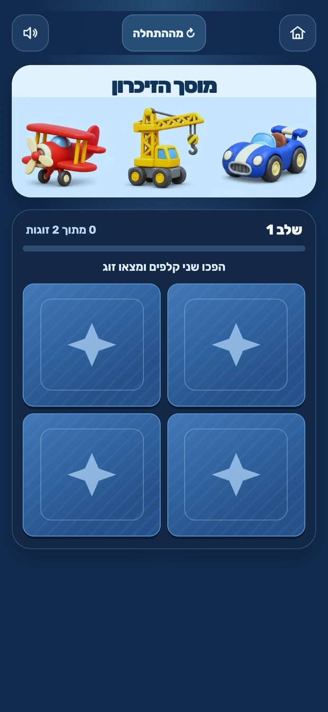
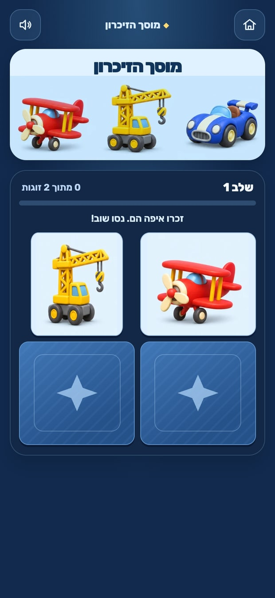
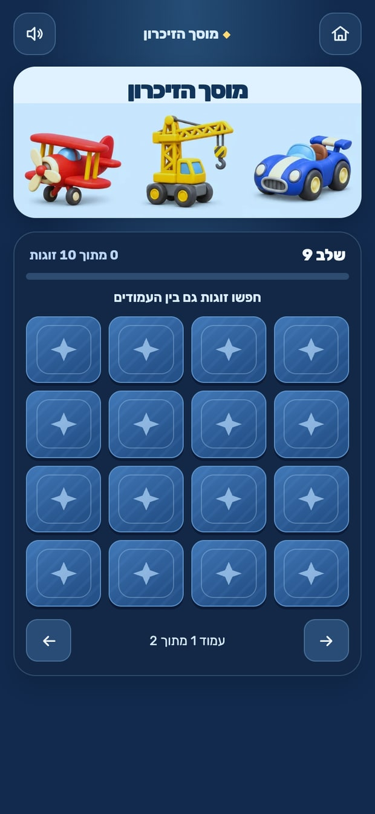

# מוסך הזיכרון

משחק זיכרון במגע עם מטוסים, מנופים וכלי רכב נוספים. מתחילים מארבעה קלפים, ובכל שלב נוסף זוג.

**[לפתוח ולשחק](https://amitshe.github.io/memory-garage/)** · **[מגרש המשחקים](https://amitshe.github.io/)**

## איך משחקים

1. הופכים שני קלפים ומחפשים כלי רכב זהים.
2. זוג שנמצא נשאר פתוח. כלי הרכב זז ומשמיע צליל קצר משלו, למשל נקישות עץ לרכבת, רפרוף למטוס או בועות לסירה. שני קלפים שונים מתהפכים בחזרה אחרי רגע.
3. כשכל הזוגות נמצאו, תיבת נגינה מלווה את תצוגת כלי הרכב ואת כפתור **לשלב הבא**. בשלב הבא נוספים שני קלפים, ואפשר להמשיך בלי שלב סיום.
4. החל מ־18 קלפים הלוח מתחלק לעמודים. משתמשים בחצים כדי לעבור ביניהם, ואפשר להתאים זוג גם כשהקלפים שלו בעמודים שונים.
5. כשהרכב מופיע עם תג ממוספר, הזוג צריך להתאים גם לפי הרכב וגם לפי התג.

אין שעון או מגבלת ניסיונות. המשחק שומר את השלב שהגעתם אליו ואת העדפת הצליל בדפדפן.

הכפתור **מההתחלה** בראש המסך ובחלון המעבר בין השלבים מחזיר ללוח של ארבעה קלפים לאחר אישור.

## צילומי מסך

<p align="center">
  
  
  
  
</p>

## הוספה למסך הבית

באייפון פותחים ב־Safari ובוחרים **שיתוף ← הוספה למסך הבית**. באנדרואיד פותחים ב־Chrome ובוחרים **הוספה למסך הבית** או **התקנה** מתפריט הדפדפן. למשחק יש אייקון ייחודי.

## הפעלה מקומית

מתוך הריפו מריצים:

```sh
python3 -m http.server 8000
```

פותחים את http://localhost:8000/. אין התקנת חבילות או שלב בנייה.

- `cards.js` מייצר ומערבב את החפיסה ואת תגי כלי הרכב.
- `game.js` מנהל הפיכות, התאמות, עמודים והתקדמות.
- `sound.js` מנגן קטעים מקובץ האודיו המקומי `assets/toy-shelf.wav` באמצעות Web Audio.
- `assets/` כולל איורי כלי רכב שנוצרו ב־ImageGen, אייקונים וגופני Rubik. רישיון הגופן מצורף.

## מקורות הצלילים

קטעי האודיו קוצרו, עובדו ושולבו בקובץ אחד. כל הדוגמאות ברישיון [CC0 1.0](https://creativecommons.org/publicdomain/zero/1.0/).

- קלימבה: [Kalimba (C-note) מאת foochie_foochie](https://freesound.org/people/foochie_foochie/sounds/331047/).
- תיבת נגינה: [Item Get מאת Qvantor](https://freesound.org/people/Qvantor/sounds/878616/).
- נקישת עץ: [Wooden Short Click! מאת Robo9418](https://freesound.org/people/Robo9418/sounds/840321/).
- בועה: [Bubble_Pop מאת arttim](https://freesound.org/people/arttim/sounds/733264/).
- רפרוף נייר: [Paper flipping in wind מאת jorgemt](https://freesound.org/people/jorgemt/sounds/789465/).

## פרסום

GitHub Pages מגיש את הקבצים משורש הענף `main` בנתיב `/memory-garage/`. הקובץ `.nojekyll` מאפשר הגשה ישירה של הקבצים.
